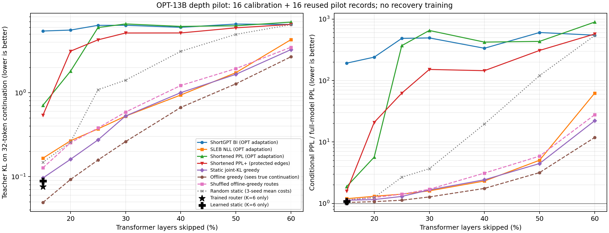

# 阶段6：论文基线与6至24层剪枝先导结果

本轮已实际新增并运行 ShortGPT-BI、SLEB-NLL、Shortened-PPL/PPL+ 的OPT适配，对15%至60%的剪层深度进行了扫描。结果是16条旧pilot上的诊断，尚非完整下游横向评测。

未训练新的大K Router。只有K=6是当前已训练Router的结果；K>6的逐样本曲线是看到了真实续写的离线贪心参考，不能部署，也不保证全局最优或仅凭提示词可学到。

完整OPT在同一16条记录上的条件续写PPL=8.5572。校准仅使用另外16条旧calibration；旧100条test未用于模型评估。OPT权重冻结，输入128 token，后续32 token质量计分。

## 方法与适配差异

- ShortGPT：按所有校准token的层输入/输出余弦差均值一次性排序。
- SLEB：每步在已跳集合上逐候选测全部159个next-token NLL，选择均值较小的候选并重新评分。
- Shortened-PPL：使用SLEB第一步相同的单层删除NLL成本，但此后不重评分，直接取一次性排名。PPL+额外保护0、1、2、3、38、39。
- 除PPL+外保护层0、1。SLEB上游默认首尾屏障、原论文数据和模型配置与本适配不同；这里不是论文默认配方的完全复现。PPL+保护范围也不同，单独标注，不能把差异全部归因于排名算法。
- 静态联合KL使用相同16条校准文档，目标与离线逐样本搜索均为32-token续写KL；每步成本针对整个已跳集合和新候选。随机路径固定三个种子，不按结果搜索最优随机集合。
- 论文、官方源码固定版本与后续BlockPruner/SkipDecode等对照安排见[补充协议](STAGE6_PAPERS_AND_DEPTH_SWEEP_20261106.zh-CN.md)。本轮没有执行这些后续方法、Taylor+或恢复训练。

**本轮校准只有16条、每条160 token的C4记录，远小于若干论文默认规模，数据、模型和保护层也经过适配。ShortGPT一次性选出的前6层为2–7，已出现灾难性质量退化；Shortened-PPL也在较深预算崩溃。这些数值只说明该具体适配/校准配置失败，不代表论文方法的典型性能，更不能据此宣称本项目击败论文。正式横向表前应在更充分的固定校准集与官方设置敏感性核对后复核。

## 各预算的条件续写质量

KL和PPL越低越好。下面PPL不是标准全量WikiText或C4语言建模PPL；不同历史数据和目标下的数值不得直接相除。随机三种子先平均NLL再取exp，不是平均三个PPL。

| 跳层K | 深度占比 | 方法 | KL | PPL | PPL/完整模型 |
| ---: | ---: | --- | ---: | ---: | ---: |
| 6 | 15% | 已有800文档学习静态，仅K6 | 0.088725 | 9.2056 | 1.076 |
| 6 | 15% | 真实续写逐样本贪心参考 | 0.049120 | 8.8664 | 1.036 |
| 6 | 15% | 贪心参考方案置换 | 0.127192 | 9.6919 | 1.133 |
| 6 | 15% | 随机静态三种子成本平均 | 0.147688 | 9.8001 | 1.145 |
| 6 | 15% | 当前已训练Router，仅K6 | 0.076015 | 9.2714 | 1.083 |
| 6 | 15% | Shortened-PPL OPT适配 | 0.707283 | 16.0866 | 1.880 |
| 6 | 15% | Shortened-PPL+首尾保护 | 0.538776 | 13.5544 | 1.584 |
| 6 | 15% | ShortGPT-BI OPT适配 | 5.434960 | 1642.8723 | 191.987 |
| 6 | 15% | SLEB-NLL OPT适配 | 0.165624 | 10.2283 | 1.195 |
| 6 | 15% | 静态联合KL贪心 | 0.096243 | 9.6284 | 1.125 |
| 8 | 20% | 真实续写逐样本贪心参考 | 0.092321 | 9.1550 | 1.070 |
| 8 | 20% | 贪心参考方案置换 | 0.253047 | 10.6731 | 1.247 |
| 8 | 20% | 随机静态三种子成本平均 | 0.257934 | 10.6637 | 1.246 |
| 8 | 20% | Shortened-PPL OPT适配 | 1.801118 | 48.5925 | 5.679 |
| 8 | 20% | Shortened-PPL+首尾保护 | 3.123607 | 178.5810 | 20.869 |
| 8 | 20% | ShortGPT-BI OPT适配 | 5.576075 | 2057.7220 | 240.467 |
| 8 | 20% | SLEB-NLL OPT适配 | 0.267239 | 11.1923 | 1.308 |
| 8 | 20% | 静态联合KL贪心 | 0.160567 | 9.9030 | 1.157 |
| 10 | 25% | 真实续写逐样本贪心参考 | 0.157749 | 9.6557 | 1.128 |
| 10 | 25% | 贪心参考方案置换 | 0.379454 | 12.1039 | 1.414 |
| 10 | 25% | 随机静态三种子成本平均 | 1.085050 | 22.8799 | 2.674 |
| 10 | 25% | Shortened-PPL OPT适配 | 5.978344 | 3165.0281 | 369.867 |
| 10 | 25% | Shortened-PPL+首尾保护 | 4.267679 | 533.3157 | 62.324 |
| 10 | 25% | ShortGPT-BI OPT适配 | 6.352806 | 4153.5913 | 485.391 |
| 10 | 25% | SLEB-NLL OPT适配 | 0.370313 | 12.1278 | 1.417 |
| 10 | 25% | 静态联合KL贪心 | 0.273814 | 11.1231 | 1.300 |
| 12 | 30% | 真实续写逐样本贪心参考 | 0.261382 | 10.9215 | 1.276 |
| 12 | 30% | 贪心参考方案置换 | 0.588092 | 14.5497 | 1.700 |
| 12 | 30% | 随机静态三种子成本平均 | 1.411248 | 31.4278 | 3.673 |
| 12 | 30% | Shortened-PPL OPT适配 | 6.602885 | 5592.5209 | 653.545 |
| 12 | 30% | Shortened-PPL+首尾保护 | 5.147434 | 1297.6827 | 151.648 |
| 12 | 30% | ShortGPT-BI OPT适配 | 6.360537 | 4229.0964 | 494.215 |
| 12 | 30% | SLEB-NLL OPT适配 | 0.525733 | 13.7117 | 1.602 |
| 12 | 30% | 静态联合KL贪心 | 0.527993 | 14.2224 | 1.662 |
| 16 | 40% | 真实续写逐样本贪心参考 | 0.666819 | 15.0209 | 1.755 |
| 16 | 40% | 贪心参考方案置换 | 1.217597 | 26.7012 | 3.120 |
| 16 | 40% | 随机静态三种子成本平均 | 3.110764 | 167.8483 | 19.615 |
| 16 | 40% | Shortened-PPL OPT适配 | 6.171102 | 3614.8650 | 422.435 |
| 16 | 40% | Shortened-PPL+首尾保护 | 5.154692 | 1239.4062 | 144.838 |
| 16 | 40% | ShortGPT-BI OPT适配 | 6.017754 | 2870.9691 | 335.503 |
| 16 | 40% | SLEB-NLL OPT适配 | 0.937695 | 19.8262 | 2.317 |
| 16 | 40% | 静态联合KL贪心 | 1.000896 | 20.7702 | 2.427 |
| 20 | 50% | 真实续写逐样本贪心参考 | 1.275129 | 27.1921 | 3.178 |
| 20 | 50% | 贪心参考方案置换 | 1.937279 | 50.3678 | 5.886 |
| 20 | 50% | 随机静态三种子成本平均 | 4.959512 | 1028.4484 | 120.185 |
| 20 | 50% | Shortened-PPL OPT适配 | 6.274223 | 3712.2414 | 433.815 |
| 20 | 50% | Shortened-PPL+首尾保护 | 5.930655 | 2645.7677 | 309.186 |
| 20 | 50% | ShortGPT-BI OPT适配 | 6.579063 | 5180.1679 | 605.358 |
| 20 | 50% | SLEB-NLL OPT适配 | 1.731687 | 43.1748 | 5.045 |
| 20 | 50% | 静态联合KL贪心 | 1.654436 | 38.1729 | 4.461 |
| 24 | 60% | 真实续写逐样本贪心参考 | 2.678490 | 101.3152 | 11.840 |
| 24 | 60% | 贪心参考方案置换 | 3.480109 | 237.2342 | 27.723 |
| 24 | 60% | 随机静态三种子成本平均 | 6.462207 | 4622.9691 | 540.243 |
| 24 | 60% | Shortened-PPL OPT适配 | 6.943437 | 7651.4752 | 894.156 |
| 24 | 60% | Shortened-PPL+首尾保护 | 6.510983 | 4896.3667 | 572.192 |
| 24 | 60% | ShortGPT-BI OPT适配 | 6.506192 | 4683.7649 | 547.348 |
| 24 | 60% | SLEB-NLL OPT适配 | 4.287037 | 532.9120 | 62.276 |
| 24 | 60% | 静态联合KL贪心 | 3.262868 | 189.6573 | 22.163 |

## 输入匹配诊断

差值为真实续写逐样本贪心参考减去置换方案，负值更好。重采样单位为16条pilot文档，10000次配对bootstrap；这些样本此前已使用，区间仅描述本诊断，不是新测试或完整训练种子不确定性。

| K | KL差 | 95%文档区间 | NLL差 | 95%文档区间 |
| ---: | ---: | --- | ---: | --- |
| 6 | -0.078073 | [-0.164038, -0.021013] | -0.089014 | [-0.195058, -0.016464] |
| 8 | -0.160726 | [-0.339226, -0.046160] | -0.153425 | [-0.355472, -0.030657] |
| 10 | -0.221705 | [-0.444230, -0.078902] | -0.225984 | [-0.467229, -0.065596] |
| 12 | -0.326709 | [-0.555137, -0.172006] | -0.286836 | [-0.514465, -0.128595] |
| 16 | -0.550778 | [-0.779387, -0.337227] | -0.575270 | [-0.807102, -0.356250] |
| 20 | -0.662150 | [-0.990590, -0.380725] | -0.616425 | [-0.982290, -0.303831] |
| 24 | -0.801619 | [-1.174694, -0.453950] | -0.850811 | [-1.273015, -0.461566] |

## 缓存与来源核验

初次2条校准/2条pilot的v1微型运行在K=24缓存分布检查处失败，失败目录完整保留。独立复核发现FP16串行缓存与并行重算平均分布差约2.40e-4、最大位置差约1.42e-3；同一路由FP32重算降至约1.50e-7与4.34e-7，所有保留/跳层KV长度正确。没有放宽原容差。

生产先导来源为新增 `tools/depth_paper_pilot_v2.py`，对当前运行另外记录FP16分布差；若超过原容差，必须以FP32确认，不能把FP32通过写成FP16等价通过。FP32仅用于缓存逻辑复核，不用于下面FP16质量曲线。

- K=6：FP16平均分布差=1.59780539e-05，最大位置差=8.91820528e-05，结果=`fp16_cache_consistent`。
- K=24：FP16平均分布差=0.00757157523，最大位置差=0.0433020517，结果=`fp16_numerical_difference_fp32_consistent`。 FP32平均差=2.17603628e-07。

验收1168条质量记录、30528次标量候选评分，核对了候选集合、完整联合状态、逐步最小值、固定路径、置换、来源split、预算与汇总。506个运行前既有文件哈希保持一致。私有token数组和旧Router检查点哈希未变。

本次耗时9.61分钟，通过统一入口使用物理GPU1、3与整个进程树21核，每worker10个torch线程。离线候选batch仅提高搜索吞吐，未用于测部署速度，不声称本轮新增了真实加速或权重显存压缩。运行目录：`runs/stage6_depth_papers_pilot_20261106_01`。

## 下一步

后续在更大K上训练纯动态、纯静态及“固定6层全局集合+动态余层”的匹配对照。扩展step embedding及第7–24步联合标签；深层分叉覆盖也同步扩展。全局集合只用训练/校准数据确定，不能用测试统计。最优K由预先声明的质量预算和开发集选择，再在冻结下游评测中报告整条曲线。

16条先导样本不能证明存在对所有输入都无用的层，也不能证明学习式动态方案必然在更深剪枝胜出。保留强静态与重新评分的论文方法，是区分全局冗余、组合效应和输入匹配收益所必需的。

汇总bootstrap的原程序按worker输出文件的目录枚举顺序读取；相同样本换序会使固定种子的有限次Monte Carlo区间端点略有变化，均值和质量表不变。验收v1因改成文件名排序而未能逐字复现这些端点；新增v2按实际生产读取顺序复算并将文件顺序存入verification。旧结果未覆盖。
